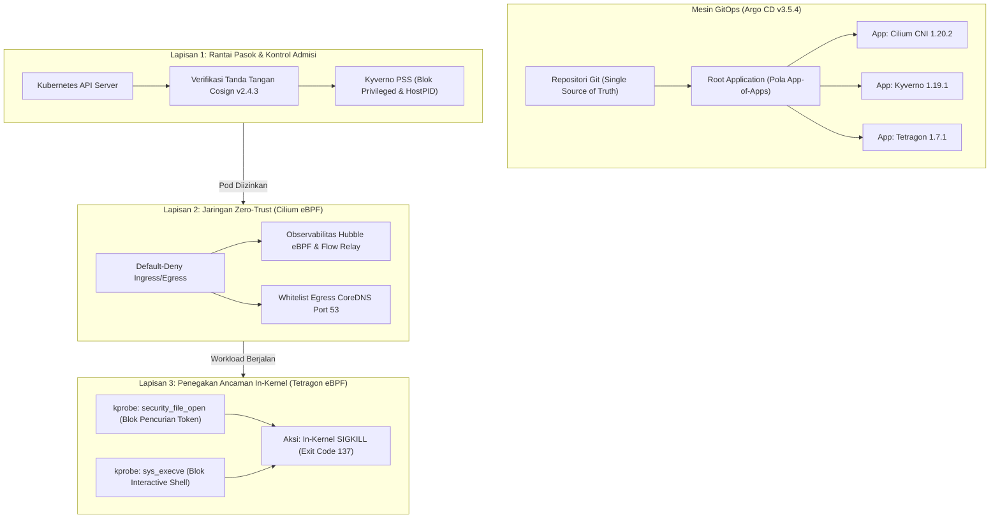

# Hardened Kubernetes Platform dengan eBPF Runtime Security & GitOps

[](https://k3s.io/)
[](https://cilium.io/)
[](https://tetragon.io/)
[](https://kyverno.io/)
[](https://argo-cd.readthedocs.io/)
[](https://docs.sigstore.dev/cosign/overview/)
[-black?logo=linux&logoColor=white)](https://kernel.org)
[-brightgreen)](#-audit-keamanan-empiris--pemetaan-mitre-attck)

> 🌐 **Navigasi Bahasa:** [English](README.md) | **Bahasa Indonesia (Aktif)**

Platform Kubernetes kelas enterprise yang diperkeras (*production-hardened*) dengan arsitektur **Triple-Layer Defense-in-Depth**. Dibangun di atas Linux Kernel 6.8 dengan kapabilitas modern eBPF, platform ini menghadirkan verifikasi kriptografis rantai pasok citra kontainer (*supply chain security*), isolasi jaringan zero-trust berbasis eBPF datapath tanpa overhead iptables, serta penegakan ancaman runtime langsung di dalam kernel Linux secara sub-milidetik (`SIGKILL`), seluruhnya dikelola secara deklaratif melalui GitOps otomatis.

Dikembangkan sebagai portofolio capstone rekayasa sistem infrastruktur cloud oleh **Natanael** (Mahasiswa Jaringan Komputer & Infrastruktur Cloud, Universitas Gadjah Mada).

---

## 📑 Daftar Isi

- [Ringkasan Arsitektur](#-ringkasan-arsitektur)
- [Matriks Pertahanan Multi-Layer](#-matriks-pertahanan-multi-layer)
- [Audit Keamanan Empiris & Pemetaan MITRE ATT&CK](#-audit-keamanan-empiris--pemetaan-mitre-attck)
- [Keputusan Rekayasa Inti & Trade-Offs Teknis](#-keputusan-rekayasa-inti--trade-offs-teknis)
- [Struktur Repositori](#-struktur-repositori)
- [Panduan Reproduksi Langkah demi Langkah](#-panduan-reproduksi-langkah-demi-langkah)
- [Suite Pengujian Keamanan Otomatis](#-suite-pengujian-keamanan-otomatis)
- [Panduan Demo Wawancara 2 Menit](#-panduan-demo-wawancara-2-menit)
- [Dokumentasi Rekayasa Mendalam](#-dokumentasi-rekayasa-mendalam)

---

## 🏛 Ringkasan Arsitektur

Klaster Kubernetes standar umumnya hanya bergantung pada pengamanan perimeter atau pemantauan userspace yang memiliki jeda deteksi (*detection latency*). Platform ini menegakkan kontrol keamanan pada tiga lapisan arsitektur independen yang saling melengkapi:



---

## 🛡 Matriks Pertahanan Multi-Layer

| Lapisan | Teknologi | Ruang Lingkup | Vektor Ancaman yang Dimitigasi | Titik Penegakan (*Enforcement Point*) |
|---|---|---|---|---|
| **Layer 0: OS & Virtualisasi** | KVM / libvirt + Ubuntu 24.04 (Kernel 6.8) | Infrastruktur | Hypervisor escape, boot node tidak terverifikasi | Isolasi KVM, kunci SSH `k3sadmin`, cloud-init minimal |
| **Layer 1: Orkestrasi** | k3s v1.36.5 (Clean CNI) | Control Plane | Permukaan serang default (Flannel, Traefik, ServiceLB dimatikan) | Flag k3s native di `/etc/rancher/k3s/config.yaml` |
| **Layer 2: Mesin GitOps** | Argo CD v3.5.4 | Manajemen Klaster | Modifikasi manual (*cluster tampering*), drift konfigurasi | Rekonsiliasi berkala (`selfHeal: true`, `prune: true`, SSA) |
| **Layer 3: Keamanan Jaringan** | Cilium 1.20.2 eBPF + Hubble | Jalur Paket L3/L4/L7 | Pergerakan lateral (*lateral movement*), port scanning, eksfiltrasi | Datapath eBPF di kernel (`tc` BPF filter, drop paket via Hubble) |
| **Layer 4: Rantai Pasok** | Kyverno v1.19.1 + Cosign v2.4.3 | Fase Admisi API | Citra kontainer tanpa otorisasi, eskalasi privilese kontainer | Kubernetes Validating & Mutating Admission Webhook |
| **Layer 5: Keamanan Runtime** | Tetragon v1.7.1 eBPF | Syscall Linux Kernel | Pencurian ServiceAccount token, breakout shell, serangan pasca-RCE | Hook kprobe kernel (`security_file_open`, `sys_execve`) dengan `SIGKILL` |

---

## 🔬 Audit Keamanan Empiris & Pemetaan MITRE ATT&CK

Setiap kontrol keamanan diuji secara ketat dengan pengujian sebelum (*baseline*) dan sesudah (*hardened*). Seluruh hasil diverifikasi secara deterministik menggunakan skrip pengujian otomatis:

| Teknik MITRE ATT&CK | Vektor Serangan | Kontrol Keamanan | Baseline (Sebelum) | Hardened (Sesudah) | Bukti Forensik & Status |
|---|---|---|---|---|---|
| **T1570: Lateral Movement** | Akses jaringan antar-pod tanpa otorisasi | Cilium eBPF NetworkPolicy | Akses Diizinkan (`HTTP 200 OK`) | **Paket Dibuang di Kernel (`exit code 28`)** | [Bukti Visual Hubble UI](docs/images/fase3_hubble-drop.png) <br> `PASS` |
| **T1611: Privilege Escalation** | Deploy pod dengan `privileged: true` | Kyverno ClusterPolicy | Pod Dibuat & Menjalankan Root Host | **Ditolak di Admisi (HTTP 403)** | Webhook memblokir sebelum masuk etcd <br> `PASS` |
| **T1610: Container Deployment** | Pod berbagi namespace PID host (`hostPID: true`) | Kyverno ClusterPolicy | Proses host terlihat di kontainer | **Ditolak di Admisi (HTTP 403)** | Webhook memblokir sebelum masuk etcd <br> `PASS` |
| **T1525: Supply Chain Tampering** | Deploy citra kontainer tanpa tanda tangan | Cosign + Kyverno `verifyImages` | Kode sembarang dijalankan | **Ditolak di Admisi (`no signatures found`)** | [Bukti Kyverno & Cosign](docs/images/kyverno-cosign-enforcement.png) <br> `PASS` |
| **T1525: Tag Poaching** | Menimpa tag OCI mutable (`:2h`) di registri | Kyverno `mutateDigest: true` | Payload kontainer diganti penyerang | **Tag Dimutasi ke Digest SHA256 Immutable** | Tag `:2h` dipin ke `@sha256:...` <br> `PASS` |
| **T1552.007: Credential Access** | Membaca token `/var/run/secrets/.../token` | Tetragon eBPF `security_file_open` | Token Terbaca (`eyJhbGci...`) | **Dibunuh di Kernel via SIGKILL (`Exit Code 137`)** | [Bukti Tetragon Sigkill](docs/images/tetragon-signkill.png) <br> `PASS` |
| **T1059.004: Command Execution** | Membuka shell interaktif (`/bin/sh`) | Tetragon eBPF `sys_execve` | Sesi shell interaktif terbuka | **Dibunuh di Kernel via SIGKILL (`Exit Code 137`)** | [Bukti Tetragon Sigkill](docs/images/tetragon-signkill.png) <br> `PASS` |
| **Akurasi Operasional (0% FP)** | Eksekusi perintah aplikasi legal (`whoami`, `uname -a`) | Presisi kprobe & logika whitelist | Berjalan normal (Exit 0) | **Berjalan normal (Exit 0, `curl_user`)** | Nol *false-positive* <br> `PASS` |
| **T1565.001: Configuration Drift** | Sabotase manual dengan `kubectl edit` | GitOps Engine Argo CD | Kluster menyimpang dari Git | **Otomatis Dipulihkan (*Self-Heal*) ke Git** | [Bukti Dashboard Argo CD](docs/images/argocd-platform-overview.png) <br> `PASS` |

---

## 💡 Keputusan Rekayasa Inti & Trade-Offs Teknis

### 1. In-Kernel `SIGKILL` vs. Pemantauan Userspace Tradisional (Contoh: Falco Standard)
- **Akar Masalah:** Daemon audit userspace tradisional membaca event jejak kernel, lalu mengirimkan sinyal `kill -9` dari userspace. Di bawah beban CPU tinggi, terdapat jeda latensi milidetik (*race window*) di mana penyerang berhasil mengeksfiltrasi token atau kunci sebelum proses sempat dibunuh.
- **Solusi yang Dipilih:** Tetragon beroperasi *langsung di dalam kernel Linux*. Ketika kprobe `security_file_open` mengevaluasi awalan path terlarang, program eBPF mengirimkan sinyal `SIGKILL` **sebelum** syscall kembali ke userspace. Proses penyerang terhenti seketika dengan exit code 137 tanpa membaca satu byte pun.

### 2. Penanganan Resolusi Symlink `/var/run` di Level VFS Kernel
- **Jebakan Sistem:** Sistem operasi Linux modern melakukan *symlink* dari `/var/run` ke direktori riil `/run`. Ketika memasang kprobe kernel pada lapisan Virtual File System (VFS `security_file_open`), kernel meneruskan penunjuk berkas kanonikal yang selalu berawalan `/run/secrets/...`.
- **Solusi yang Dipilih:** Kebijakan `TracingPolicyNamespaced` mendefinisikan awalan untuk kedua jalur: `/run/secrets/...` dan `/var/run/secrets/...`, menjamin penegakan keamanan tetap kokoh tanpa memedulikan semantik resolusi path aplikasi.

### 3. Libc `getpwuid()` vs. Whitelist `/etc/passwd`
- **Jebakan Sistem:** Memblokir pembacaan berkas identitas `/etc/passwd` akan merusak inisialisasi runtime kontainer (`runc`) dan biner libc standar (seperti `whoami`) yang memanggil fungsi sistem `getpwuid()` untuk mencari nama pengguna.
- **Solusi yang Dipilih:** Kebijakan diarahkan secara presisi ke berkas hash kata sandi `/etc/shadow` dan direktori ServiceAccount token Kubernetes, mempertahankan kompatibilitas aplikasi 100% tanpa celah pencurian kredensial.

### 4. Normalisasi Diff Kamus Kosong Argo CD (`ignoreDifferences`)
- **Jebakan Sistem:** Helm subchart upstream pihak ketiga (seperti `kyverno-api`) kerap kali menghasilkan kamus kosong (`labels: {}`). Kubernetes API Server menghapus entri kamus kosong saat menyimpannya ke etcd, menyebabkan kalkulasi 3-way diff Argo CD mendeteksi status `OutOfSync` permanen.
- **Solusi yang Dipilih:** Menerapkan konfigurasi `ignoreDifferences` deklaratif pada resource `CustomResourceDefinition` dengan `jqPathExpressions: [".metadata.labels"]`, sehingga status sinkronisasi GitOps menjadi hijau bersih dan terprediksi.

---

## 📂 Struktur Repositori

```text
k8s-hardened-platform/
├── README.md                               # Dokumentasi etalase utama (Bahasa Inggris Profesional)
├── README.id.md                            # Dokumentasi etalase lengkap (Bahasa Indonesia)
├── .gitignore                              # Melindungi kunci privat (*.key) & citra VM
├── docs/                                   # Laporan teknis arsitektur & rekayasa sistem mendalam
│   ├── 00-persiapan-host.md                # Virtualisasi host KVM & validasi modul
│   ├── 01-jaringan-virtual.md              # Desain topologi jaringan virtual NAT libvirt
│   ├── 02-vm-node.md                       # Arsitektur 3 VM Ubuntu 24.04 berbasis cloud-init
│   ├── 03-kernel-node.md                   # Audit kernel Linux 6.8 (BTF, eBPF, LSM)
│   ├── 04-k3s-cluster.md                   # Bootstrap klaster k3s v1.36.5 dengan clean CNI
│   ├── 05-cilium-dan-akses-kubectl.md      # Pemasangan Cilium 1.20.2 & uji konektivitas 82/82
│   ├── 06-argocd-dan-gitops.md             # Pola App-of-Apps GitOps Argo CD v3.5.4
│   ├── 07-observabilitas-hubble-dan-networkpolicy.md # Hubble eBPF & isolasi Zero-Trust
│   ├── 08-supply-chain-kyverno-dan-cosign.md        # Verifikasi tanda tangan Cosign & PSS
│   ├── 09-runtime-security-tetragon.md              # Penegakan ancaman in-kernel Tetragon SIGKILL
│   ├── 10-laporan-pengujian-keamanan-end-to-end.md  # Laporan komprehensif audit keamanan menyeluruh
│   ├── panduan-demo-wawancara.md           # Panduan demonstrasi langsung wawancara teknis 2 menit
│   └── images/                             # Bukti forensik visual & tangkapan layar verifikasi
├── gitops/                                 # Manifest infrastruktur GitOps deklaratif
│   ├── bootstrap/
│   │   ├── root-application.yaml           # Parent Application master (pola App-of-Apps)
│   │   └── apps/                           # Child Application CRD (cilium, kyverno, tetragon)
│   └── platform/                           # Nilai konfigurasi kustom Helm per komponen
│       ├── cilium/values.yaml              # Integrasi CIDR pod k3s & aktivasi Hubble Relay/UI
│       ├── kyverno/values.yaml             # Optimasi lab single replica (non-HA)
│       └── tetragon/values.yaml            # Instalasi CRD Operator & konfigurasi DaemonSet
├── policies/                               # Kebijakan Keamanan Deklaratif
│   ├── networkpolicy/                      # Zero-Trust default-deny & ingress selektif
│   ├── kyverno/                            # Standar keamanan pod (PSS) & verifikasi tanda tangan
│   └── tracingpolicy/                      # Aturan penegakan runtime in-kernel Tetragon eBPF
└── attack-tests/                           # Harness simulasi serangan empiris & skrip audit
    ├── run-all-verifications.sh            # Skrip audit otomatis master (9/9 pengujian)
    └── kyverno/                            # Pod uji privilese, hostPID, dan unsigned image
```

---

## 🚀 Panduan Reproduksi Langkah demi Langkah

### Prasyarat Sistem
- **Host:** Linux x86_64 (disarankan Ubuntu 24.04 LTS) dengan virtualisasi perangkat keras (VT-x / AMD-V) aktif.
- **Memori RAM:** Minimal 16 GB (Alokasi: Server 4GB, Agent1 3GB, Agent2 3GB).
- **Perkakas di Host:** `virsh`, `kubectl`, `helm`, `cosign`, `tetra`, `argocd`.

### 1. Klon Repositori & Persiapan Workspace
```bash
git clone https://github.com/nael0407/k8s-hardened-platform.git
cd k8s-hardened-platform
export KUBECONFIG=~/.kube/k3s-lab.yaml
```

### 2. Bootstrap Mesin GitOps (Root Application)
Setelah 3 VM dan k3s diinisialisasi (rincian lengkap di [docs/04](docs/04-k3s-cluster.md)), terapkan root application GitOps:
```bash
kubectl apply -f gitops/bootstrap/root-application.yaml
```
Argo CD akan secara otomatis mendeteksi, mengunduh, dan merekonsiliasi CNI Cilium, Kyverno Admission Controller, serta Tetragon eBPF Runtime Security sesuai urutan dependensi.

### 3. Terapkan Kebijakan Keamanan Multi-Layer
```bash
# Lapisan Keamanan Jaringan (Zero-Trust)
kubectl apply -f policies/networkpolicy/

# Lapisan Rantai Pasok & Pod Security (Kyverno)
kubectl apply -f policies/kyverno/

# Lapisan Penegakan Runtime In-Kernel (Tetragon)
kubectl apply -f policies/tracingpolicy/
```

---

## ⚡ Suite Pengujian Keamanan Otomatis

Untuk menjalankan seluruh 9 poin uji penetrasi dan verifikasi keamanan dalam kurun waktu kurang dari 20 detik:

```bash
./attack-tests/run-all-verifications.sh
```

**Hasil Keluaran Terminal:**
```text
====================================================================
  K8S HARDENED PLATFORM - AUTOMATED END-TO-END SECURITY AUDIT       
====================================================================

Phase A: Network Security (Cilium eBPF Zero-Trust)
  [✔ PASS] Zero-Trust: Frontend Legitimate Ingress
          Evidence: HTTP 200 OK from backend-svc
  [✔ PASS] Zero-Trust: Attacker Lateral Movement Blocked
          Evidence: eBPF Packet Dropped (curl exit code 28 timeout)

Phase B: Supply Chain Security & Admission Control (Kyverno + Cosign)
  [✔ PASS] Admission Control: Privileged Pod Denial
          Evidence: Blocked by Kyverno (disallow-privileged-containers)
  [✔ PASS] Admission Control: HostPID Namespace Denial
          Evidence: Blocked by Kyverno (disallow-host-namespaces)
  [✔ PASS] Supply Chain: Unsigned Image Admission Rejection
          Evidence: Blocked by Cosign policy (no signatures found)

Phase C: In-Kernel Runtime Threat Enforcement (Tetragon eBPF)
  [✔ PASS] Runtime Enforcement: ServiceAccount Token Harvesting
          Evidence: Killed in-kernel by Tetragon SIGKILL (Exit Code 137)
  [✔ PASS] Runtime Enforcement: Unauthorized Interactive Shell Execution
          Evidence: Killed in-kernel by Tetragon SIGKILL (Exit Code 137)
  [✔ PASS] Runtime Accuracy: Benign Application Execution
          Evidence: whoami successfully returned 'curl_user' (Exit Code 0)

Phase D: GitOps Engine State (Argo CD)
  [✔ PASS] GitOps: Platform Applications Health
          Evidence: Cilium (Healthy), Kyverno (Healthy), Tetragon (Healthy)

====================================================================
  AUDIT SUMMARY: 9/9 CHECKS PASSED
  STATUS: ALL DEFENSE LAYERS FUNCTIONING PERFECTLY!
====================================================================
```

---

## 📖 Dokumentasi Rekayasa Mendalam

Untuk laporan mendalam mengenai setiap fase rekayasa, keputusan arsitektur, dan log terminal lengkap:

- [00. Persiapan Host & Verifikasi Virtualisasi KVM](docs/00-persiapan-host.md)
- [01. Desain Arsitektur Jaringan Virtual Libvirt](docs/01-jaringan-virtual.md)
- [02. Otomasi Provisioning Virtual Machine dengan Cloud-Init](docs/02-vm-node.md)
- [03. Verifikasi Kernel Linux & Audit BTF/eBPF](docs/03-kernel-node.md)
- [04. Bootstrap Klaster k3s dengan Custom Clean CNI](docs/04-k3s-cluster.md)
- [05. Deployment Cilium CNI 1.20.2 & Konfigurasi Kubectl](docs/05-cilium-dan-akses-kubectl.md)
- [06. Adopsi GitOps Argo CD v3.5.4 Pola App-of-Apps](docs/06-argocd-dan-gitops.md)
- [07. Observabilitas Hubble eBPF & Kebijakan Zero-Trust](docs/07-observabilitas-hubble-dan-networkpolicy.md)
- [08. Keamanan Rantai Pasok dengan Kyverno & Cosign](docs/08-supply-chain-kyverno-dan-cosign.md)
- [09. Keamanan Runtime eBPF & Penegakan In-Kernel Tetragon](docs/09-runtime-security-tetragon.md)
- [10. Laporan Pengujian Keamanan Komprehensif End-to-End](docs/10-laporan-pengujian-keamanan-end-to-end.md)
- [Panduan Praktis Demonstrasi Langsung Wawancara 2 Menit](docs/panduan-demo-wawancara.md)

---

## 👤 Pengembang

**Natanael**  
*Departemen Teknik Elektro dan Teknologi Informasi, Universitas Gadjah Mada (UGM)*  
Fokus Keahlian: Computer Networks, Cloud Infrastructure, and Platform DevSecOps.  
- GitHub: [@nael0407](https://github.com/nael0407)  
- Repositori Proyek: [k8s-hardened-platform](https://github.com/nael0407/k8s-hardened-platform)
