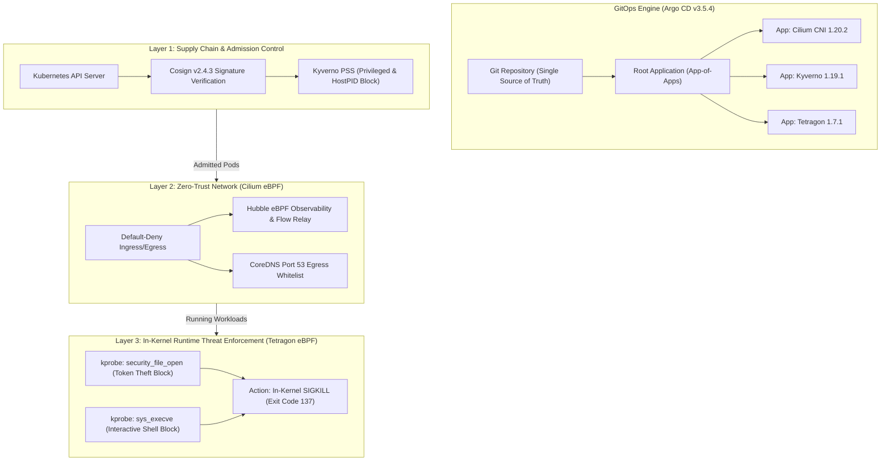

# Hardened Kubernetes Platform with eBPF Runtime Security & GitOps

[](https://k3s.io/)
[](https://cilium.io/)
[](https://tetragon.io/)
[](https://kyverno.io/)
[](https://argo-cd.readthedocs.io/)
[](https://docs.sigstore.dev/cosign/overview/)
[-black?logo=linux&logoColor=white)](https://kernel.org)
[-brightgreen)](#-empirical-security-audit--mitre-attck-mapping)

> 🌐 **Language Navigation:** **English (Current)** | [Versi Bahasa Indonesia](README.id.md)

An enterprise-grade, production-hardened Kubernetes platform engineered with a **Triple-Layer Defense-in-Depth** architecture. Built on Linux Kernel 6.8 with eBPF technology, it provides cryptographic supply chain verification, kernel-level zero-trust network isolation, and sub-millisecond in-kernel runtime threat enforcement (`SIGKILL`), fully automated through declarative GitOps.

Developed as a capstone systems engineering portfolio by **Natanael** (Undergraduate in Networking & Cloud Infrastructure, Universitas Gadjah Mada).

---

## 📑 Table of Contents

- [Architectural Overview](#-architectural-overview)
- [Multi-Layer Defense Matrix](#-multi-layer-defense-matrix)
- [Empirical Security Audit & MITRE ATT&CK Mapping](#-empirical-security-audit--mitre-attck-mapping)
- [Core Engineering Decisions & Trade-Offs](#-core-engineering-decisions--trade-offs)
- [Repository Structure](#-repository-structure)
- [Step-by-Step Reproduction Guide](#-step-by-step-reproduction-guide)
- [Automated Security Audit Suite](#-automated-security-audit-suite)
- [2-Minute Interview Demonstration Guide](#-2-minute-interview-demonstration-guide)
- [Comprehensive Engineering Documentation](#-comprehensive-engineering-documentation)

---

## 🏛 Architectural Overview

Standard Kubernetes deployments often rely on perimeter defenses or userspace monitoring agents with inherent detection latency. This platform enforces security at three distinct, non-overlapping architectural layers:



---

## 🛡 Multi-Layer Defense Matrix

| Layer | Technology | Scope | Threat Vectors Mitigated | Enforcement Point |
|---|---|---|---|---|
| **Layer 0: OS & Virtualization** | KVM / libvirt + Ubuntu 24.04 (Kernel 6.8) | Infrastructure | Hypervisor escape, unverified node boot | KVM isolation, locked `k3sadmin` SSH keys, minimal cloud-init |
| **Layer 1: Orchestration** | k3s v1.36.5 (Clean CNI) | Control Plane | Unnecessary default surface (Flannel, Traefik, ServiceLB disabled) | Native k3s flags in `/etc/rancher/k3s/config.yaml` |
| **Layer 2: GitOps Engine** | Argo CD v3.5.4 | Cluster Management | Manual cluster tampering, configuration drift | Continuous reconciliation (`selfHeal: true`, `prune: true`, SSA) |
| **Layer 3: Network Security** | Cilium 1.20.2 eBPF + Hubble | L3/L4/L7 Packet Path | Lateral movement, port scanning, unauthorized egress | In-kernel eBPF datapath (`tc` BPF filter, Hubble packet drop) |
| **Layer 4: Supply Chain** | Kyverno v1.19.1 + Cosign v2.4.3 | Admission Phase | Tampered container images, container privilege escalation | Kubernetes Validating & Mutating Admission Webhook |
| **Layer 5: Runtime Security** | Tetragon v1.7.1 eBPF | Linux Kernel Syscalls | ServiceAccount token harvesting, shell breakout, post-RCE | In-kernel kprobe hook (`security_file_open`, `sys_execve`) with `SIGKILL` |

---

## 🔬 Empirical Security Audit & MITRE ATT&CK Mapping

Every security control was subjected to rigorous before-and-after empirical testing. Results are verified deterministically via our automated test harness:

| MITRE ATT&CK Technique | Attack Vector | Security Control | Baseline (Before) | Hardened (After) | Forensic Proof & Status |
|---|---|---|---|---|---|
| **T1570: Lateral Movement** | Unauthorized pod-to-pod network traffic | Cilium eBPF NetworkPolicy | Traffic Allowed (`HTTP 200 OK`) | **Packet Dropped (`exit code 28`)** | [Hubble UI Visual Drop](docs/images/fase3_hubble-drop.png) <br> `PASS` |
| **T1611: Privilege Escalation** | Deploying pod with `privileged: true` | Kyverno ClusterPolicy | Pod Scheduled & Running | **Rejected at Admission (HTTP 403)** | Webhook blocked before etcd <br> `PASS` |
| **T1610: Container Deployment** | Pod sharing host PID namespace (`hostPID: true`) | Kyverno ClusterPolicy | Host processes exposed | **Rejected at Admission (HTTP 403)** | Webhook blocked before etcd <br> `PASS` |
| **T1525: Supply Chain Tampering** | Deploying unsigned container image | Cosign + Kyverno `verifyImages` | Arbitrary code runs | **Rejected at Admission (`no signatures found`)** | [Kyverno Cosign Evidence](docs/images/kyverno-cosign-enforcement.png) <br> `PASS` |
| **T1525: Tag Poaching** | Overwriting mutable OCI tag (`:2h`) in registry | Kyverno `mutateDigest: true` | Image payload swapped | **Tag Mutated to Immutable SHA256 Digest** | Tag `:2h` pinned to `@sha256:...` <br> `PASS` |
| **T1552.007: Credential Access** | Reading `/var/run/secrets/.../token` | Tetragon eBPF `security_file_open` | Token Harvested (`eyJhbGci...`) | **In-Kernel SIGKILL (`Exit Code 137`)** | [Tetragon Sigkill Evidence](docs/images/tetragon-signkill.png) <br> `PASS` |
| **T1059.004: Command Execution** | Spawning interactive shell (`/bin/sh`) | Tetragon eBPF `sys_execve` | Shell session opened | **In-Kernel SIGKILL (`Exit Code 137`)** | [Tetragon Sigkill Evidence](docs/images/tetragon-signkill.png) <br> `PASS` |
| **Legitimate Accuracy (0% FP)** | Standard commands (`whoami`, `uname -a`) | Whitelist logic & kprobe precision | Allowed (Exit 0) | **Allowed (Exit 0, `curl_user`)** | Zero false-positives <br> `PASS` |
| **T1565.001: Configuration Drift** | Manual `kubectl edit` tampering | Argo CD GitOps Engine | Cluster state modified | **Automatically Healed back to Git spec** | [Argo CD Platform Overview](docs/images/argocd-platform-overview.png) <br> `PASS` |

---

## 💡 Core Engineering Decisions & Trade-Offs

### 1. In-Kernel `SIGKILL` vs. Userspace Monitoring (e.g., Traditional Falco)
- **The Problem:** Traditional userspace audit daemons read trace events and invoke `kill -9` from userspace. Under CPU load, this introduces a millisecond-level race window where attackers can complete exfiltrating credentials before termination.
- **The Solution:** Tetragon operates *inside the kernel*. When `security_file_open` evaluates a blacklisted path prefix, the eBPF program dispatches a fatal `SIGKILL` signal **before** the syscall returns to userspace. The attacker process receives exit code 137 without reading a single byte.

### 2. The `/var/run` Symlink Resolution Caveat
- **The Trap:** Linux systems symlink `/var/run` to `/run`. When configuring kernel kprobes on VFS (`security_file_open`), the kernel passes canonical file pointers whose path starts with `/run/secrets/...`.
- **The Fix:** Policies specify prefixes for both `/run/secrets/...` and `/var/run/secrets/...`, ensuring bulletproof enforcement regardless of path resolution semantics.

### 3. Libc `getpwuid()` vs. `/etc/passwd` Whitelisting
- **The Trap:** Blocking `/etc/passwd` immediately breaks container runtime initializers (`runc`) and standard libc functions (like `whoami`), which call `getpwuid()` to resolve usernames.
- **The Fix:** Targeted `/etc/shadow` (password hashes) and Kubernetes secret paths, maintaining 100% operational fidelity while eliminating credential theft vectors.

### 4. Argo CD Empty Dictionary Diff Normalization (`ignoreDifferences`)
- **The Trap:** Upstream Helm subcharts (such as `kyverno-api`) often template empty maps (`labels: {}`). Kubernetes API Server strips empty maps upon saving to etcd, causing Argo CD's 3-way diff to report permanent `OutOfSync`.
- **The Fix:** Implemented `ignoreDifferences` targeting `CustomResourceDefinition` with `jqPathExpressions: [".metadata.labels"]` in the Application manifest, achieving clean, green GitOps synchronization.

---

## 📂 Repository Structure

```text
k8s-hardened-platform/
├── README.md                               # Primary showcase documentation (English)
├── README.id.md                            # Complete engineering documentation (Bahasa Indonesia)
├── .gitignore                              # Protects private keys (*.key) & virtual disks
├── docs/                                   # In-depth architectural & operational reports
│   ├── 00-persiapan-host.md                # Host virtualization & KVM verification
│   ├── 01-jaringan-virtual.md              # Libvirt NAT virtual network design
│   ├── 02-vm-node.md                       # Ubuntu 24.04 cloud-init 3-VM architecture
│   ├── 03-kernel-node.md                   # Linux 6.8 kernel audit (BTF, eBPF, LSM)
│   ├── 04-k3s-cluster.md                   # k3s v1.36.5 custom CNI cluster bootstrap
│   ├── 05-cilium-dan-akses-kubectl.md      # Cilium 1.20.2 deployment & connectivity test
│   ├── 06-argocd-dan-gitops.md             # Argo CD v3.5.4 App-of-Apps GitOps adoption
│   ├── 07-observabilitas-hubble-dan-networkpolicy.md # Hubble eBPF & Zero-Trust policies
│   ├── 08-supply-chain-kyverno-dan-cosign.md        # Kyverno PSS & Cosign signature audit
│   ├── 09-runtime-security-tetragon.md              # Tetragon in-kernel SIGKILL enforcement
│   ├── 10-laporan-pengujian-keamanan-end-to-end.md  # Comprehensive end-to-end audit report
│   ├── panduan-demo-wawancara.md           # 2-minute live interview demonstration guide
│   └── images/                             # Verification screenshots & visual evidence
├── gitops/                                 # Declarative GitOps infrastructure manifests
│   ├── bootstrap/
│   │   ├── root-application.yaml           # Master App-of-Apps parent application
│   │   └── apps/                           # Child Application CRDs (cilium, kyverno, tetragon)
│   └── platform/                           # Tailored Helm value overrides per component
│       ├── cilium/values.yaml              # Pod CIDR alignment & Hubble activation
│       ├── kyverno/values.yaml             # Non-HA single replica lab optimization
│       └── tetragon/values.yaml            # Operator CRD installation & DaemonSet config
├── policies/                               # Declarative Security Policies
│   ├── networkpolicy/                      # Zero-Trust default-deny & selective ingress
│   ├── kyverno/                            # Pod Security Standards & Cosign verification
│   └── tracingpolicy/                      # Tetragon in-kernel runtime enforcement rules
└── attack-tests/                           # Empirical verification & penetration test harness
    ├── run-all-verifications.sh            # Automated master audit script (9/9 checks)
    └── kyverno/                            # Privileged, hostPID, and signature test pods
```

---

## 🚀 Step-by-Step Reproduction Guide

### Prerequisites
- Host: Linux x86_64 (Ubuntu 24.04 LTS recommended) with VT-x/AMD-V virtualization enabled.
- RAM: Minimum 16 GB (Allocated: Server 4GB, Agent1 3GB, Agent2 3GB).
- Tools on Host: `virsh`, `kubectl`, `helm`, `cosign`, `tetra`, `argocd`.

### 1. Clone & Setup Workspace
```bash
git clone https://github.com/nael0407/k8s-hardened-platform.git
cd k8s-hardened-platform
export KUBECONFIG=~/.kube/k3s-lab.yaml
```

### 2. Bootstrap GitOps Root Application
Once the 3 VMs and k3s are initialized (detailed in [docs/04](docs/04-k3s-cluster.md)), deploy the GitOps engine:
```bash
kubectl apply -f gitops/bootstrap/root-application.yaml
```
Argo CD will automatically discover, install, and reconcile Cilium CNI, Kyverno Admission Controller, and Tetragon eBPF Runtime Security in dependency order.

### 3. Deploy Security Policies
```bash
# Network Security (Zero-Trust)
kubectl apply -f policies/networkpolicy/

# Supply Chain & Pod Security (Kyverno)
kubectl apply -f policies/kyverno/

# In-Kernel Threat Enforcement (Tetragon)
kubectl apply -f policies/tracingpolicy/
```

---

## ⚡ Automated Security Audit Suite

To execute the entire 9-point penetration and verification audit suite in under 20 seconds:

```bash
./attack-tests/run-all-verifications.sh
```

**Expected Output:**
```text
====================================================================
  K8S HARDENED PLATFORM - AUTOMATED END-TO-END SECURITY AUDIT       
====================================================================

Phase A: Network Security (Cilium eBPF Zero-Trust)
  [✔ PASS] Zero-Trust: Frontend Legitimate Ingress
         Evidence: HTTP 200 OK from backend-svc
  [✔ PASS] Zero-Trust: Attacker Lateral Movement Blocked
         Evidence: eBPF Packet Dropped (curl exit code 28 timeout)

Phase B: Supply Chain Security & Admission Control (Kyverno + Cosign)
  [✔ PASS] Admission Control: Privileged Pod Denial
         Evidence: Blocked by Kyverno (disallow-privileged-containers)
  [✔ PASS] Admission Control: HostPID Namespace Denial
         Evidence: Blocked by Kyverno (disallow-host-namespaces)
  [✔ PASS] Supply Chain: Unsigned Image Admission Rejection
         Evidence: Blocked by Cosign policy (no signatures found)

Phase C: In-Kernel Runtime Threat Enforcement (Tetragon eBPF)
  [✔ PASS] Runtime Enforcement: ServiceAccount Token Harvesting
         Evidence: Killed in-kernel by Tetragon SIGKILL (Exit Code 137)
  [✔ PASS] Runtime Enforcement: Unauthorized Interactive Shell Execution
         Evidence: Killed in-kernel by Tetragon SIGKILL (Exit Code 137)
  [✔ PASS] Runtime Accuracy: Benign Application Execution
         Evidence: whoami successfully returned 'curl_user' (Exit Code 0)

Phase D: GitOps Engine State (Argo CD)
  [✔ PASS] GitOps: Platform Applications Health
         Evidence: Cilium (Healthy), Kyverno (Healthy), Tetragon (Healthy)

====================================================================
  AUDIT SUMMARY: 9/9 CHECKS PASSED
  STATUS: ALL DEFENSE LAYERS FUNCTIONING PERFECTLY!
====================================================================
```

---

## 🎤 2-Minute Interview Demonstration Guide

When asked to showcase this project during technical interviews:

1. **Show Network Dropping (Layer 3):**
   ```bash
   kubectl -n secure-demo exec attacker -- curl -s -I -m 3 http://backend-svc
   # Explain: "Cilium eBPF datapath drops lateral packets at L3/L4 with zero iptables overhead."
   ```
2. **Show Supply Chain Denial (Layer 4):**
   ```bash
   kubectl apply -f attack-tests/kyverno/04-unsigned-image-pod.yaml
   # Explain: "Kyverno Validating Webhook verifies Cosign ECDSA signatures at the API gateway before scheduling."
   ```
3. **Show In-Kernel SIGKILL (Layer 5):**
   ```bash
   kubectl -n secure-demo exec attacker -- cat /var/run/secrets/kubernetes.io/serviceaccount/token
   # Explain: "Tetragon kprobe intercepts the VFS file open and terminates the process with SIGKILL (Exit Code 137)."
   ```

*Complete step-by-step interview script available in [docs/panduan-demo-wawancara.md](docs/panduan-demo-wawancara.md).*

---

## 📖 Comprehensive Engineering Documentation

For exhaustive technical deep-dives, design rationale, and raw terminal logs:

- [00. Host Preparation & Virtualization Baseline](docs/00-persiapan-host.md)
- [01. Libvirt Virtual Network Architecture](docs/01-jaringan-virtual.md)
- [02. Virtual Machine Provisioning & Cloud-Init](docs/02-vm-node.md)
- [03. Linux Kernel Verification & BTF Audit](docs/03-kernel-node.md)
- [04. k3s Cluster Bootstrap with Custom CNI](docs/04-k3s-cluster.md)
- [05. Cilium CNI 1.20.2 & Kubectl Access](docs/05-cilium-dan-akses-kubectl.md)
- [06. Argo CD v3.5.4 & App-of-Apps GitOps Adoption](docs/06-argocd-dan-gitops.md)
- [07. Hubble Observability & Zero-Trust NetworkPolicy](docs/07-observabilitas-hubble-dan-networkpolicy.md)
- [08. Supply Chain Security with Kyverno & Cosign](docs/08-supply-chain-kyverno-dan-cosign.md)
- [09. Runtime Security with Tetragon eBPF Enforcement](docs/09-runtime-security-tetragon.md)
- [10. Comprehensive End-to-End Security Audit Report](docs/10-laporan-pengujian-keamanan-end-to-end.md)

---

## 👤 Author

**Natanael**  
*Department of Electrical Engineering and Information Technology, Universitas Gadjah Mada*  
Specialization: Computer Networks, Cloud Infrastructure, and Platform DevSecOps.  
- GitHub: [@nael0407](https://github.com/nael0407)
- Repository: [k8s-hardened-platform](https://github.com/nael0407/k8s-hardened-platform)
