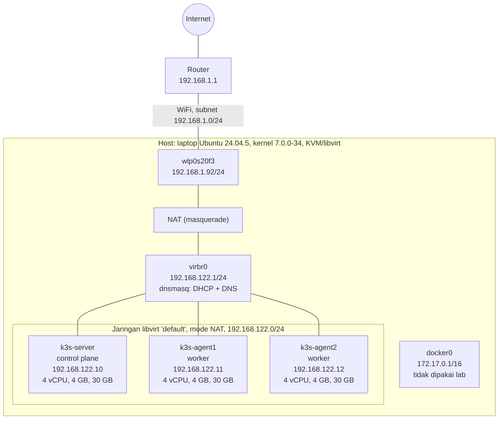

# Topologi Jaringan Lab

Diagram ini dibuat dari output terukur: `ip -br addr`, `ip route`, `virsh net-dumpxml default`, dan `virsh domifaddr` (lihat `01-jaringan-virtual.md` dan `02-vm-node.md`). GitHub merender blok Mermaid di bawah secara otomatis.

## Fase 0: host, jaringan virtual, dan tiga VM

## Tabel node

| VM | Peran | MAC | IP | Perangkat |
|---|---|---|---|---|
| k3s-server | control plane | `52:54:00:00:00:10` | `192.168.122.10` | virtio, UEFI |
| k3s-agent1 | worker | `52:54:00:00:00:11` | `192.168.122.11` | virtio, UEFI |
| k3s-agent2 | worker | `52:54:00:00:00:12` | `192.168.122.12` | virtio, UEFI |

## Catatan membaca diagram

- **Arah akses.** VM bisa keluar ke internet lewat NAT di host, tetapi tidak terlihat dari luar laptop. Akses ke node dilakukan dari host lewat SSH (`ssh -i ~/.ssh/k8s-lab k8sadmin@<IP>`).
- **Alamat tetap.** IP ketiga node dipesan lewat DHCP reservation di libvirt (MAC tetap dipetakan ke IP tetap), sehingga tidak berubah saat VM dinyalakan ulang.
- **`docker0` terpisah.** Bridge Docker di host memakai subnet `172.17.0.0/16`, tidak bentrok dan tidak terhubung dengan jaringan lab.
- **Belum tercakup.** Jaringan di dalam klaster (CIDR pod dan service, Cilium, Hubble) belum ada pada fase ini. Diagram bagian itu ditambahkan setelah k3s dan Cilium terpasang.
